# Performance bugs

## Результаты

| Бенчмарк | До | После | Ускорение |
|---|---:|---:|---:|
| `bm_scale_components` | 28.8 ms | 4.58 ms | 6.29× |
| `bm_compute_pi/threads:2` | 579 ns | 16.9 ns | 34.26× |
| `bm_radix_sort` | 9197 ms | 1124 ms | 8.18× |
| `bm_message_to_json` | 566 ns | 204 ns | 2.77× |
| `bm_logger/threads:1` | 325 ns | 10.5 ns | 30.95× |

---

## JPEG

Jpeg: основную часть времени выполняются конструктор копирования(по __unitialized_copy_a понятно что именно копирования), деструктор Picture и scale_down. std::_Vector_base<int, std::allocator<int> >::_M_allocate/_M_deallocate составляют основную их массу, поэтому делаем вывод что проблема в аллокациях вектора. 600*800 аллокаций для внутреннего измерения. Заменим std::vector на std::array, чтобы избежать этого.

### Бенчмарк

| До | После |
|---|---|
| **28.8 ms** | **4.58 ms** |
| 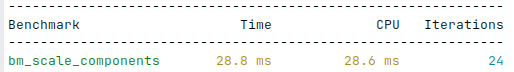 | 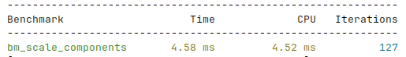 |

### perf

| До | После |
|---|---|
| [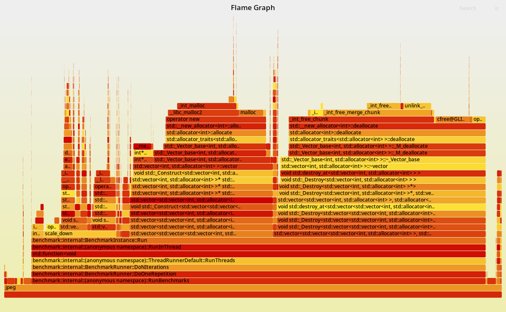](mr_assets/jpeg_before.svg) | [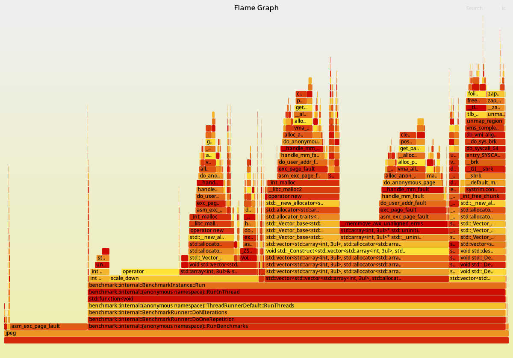](mr_assets/jpeg_after.svg) |

---

## PI

Pi: видно, почти всё время занимает std::rand, доля умножения в operator() крайне мала, значит std::rand очень медленный. Оказывается при std::rand потоки вынуждены ждать друг друга, чтобы обновить глобальное состояние. Поэтому сделаем по генератору на каждый поток. Тогда получается заметно быстрее, но пока не 50+ раз ускорение. Заметим что uniform distribution сьедает в два раза больше чем mt, и в целом то можно обойтись и без него, так как mt и сам генерирует целые числа. И еще одна оптимизация по времени генерации: нам нужны числа до 1000, поэтому один раз будем запускать mt() и делить его пополам.

### Бенчмарк

| До | После |
|---|---|
| **579 ns** | **16.9 ns** |
| 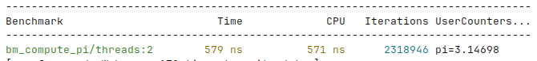 | 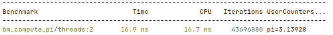 |

### perf

| До | После |
|---|---|
| [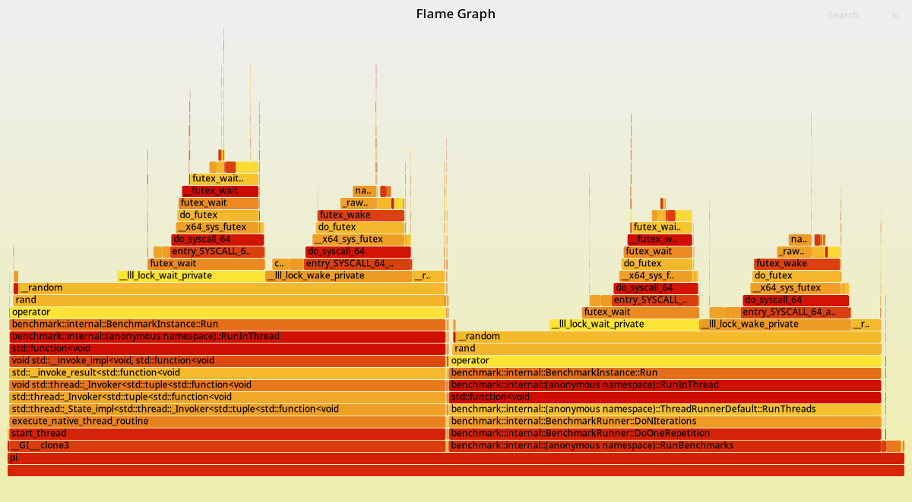](mr_assets/pi_before.svg) | [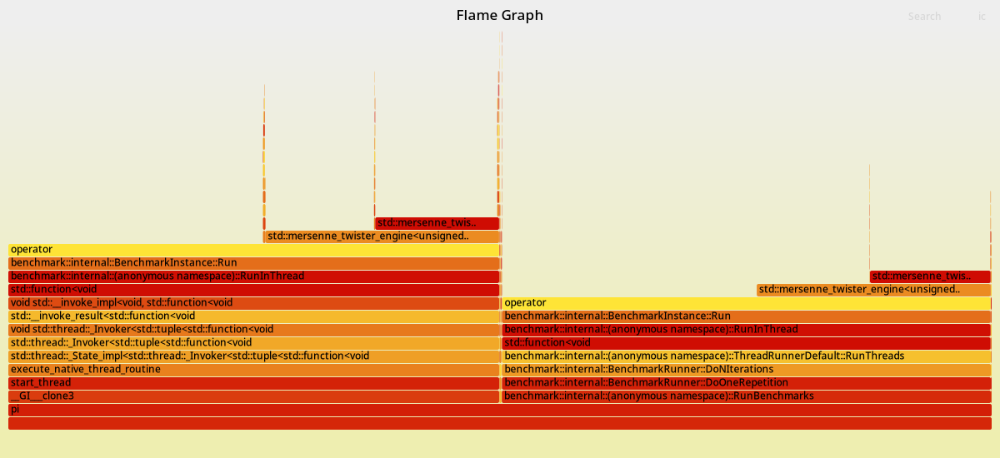](mr_assets/pi_after.svg) |

---

## Radix sort

Radix sort: смотрим на график - radix_sort сам по себе занимает много места и аллокация вектора внутри него тоже много. Посмотрим на алгоритм и поймем что можно сделать меньше итераций, проходя не каждый бит, а группами. Оптимизация в 10 раз.

### Бенчмарк

| До | После |
|---|---|
| **9197 ms** | **1124 ms** |
| 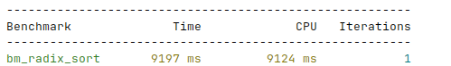 | 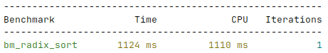 |

### perf

| До | После |
|---|---|
| [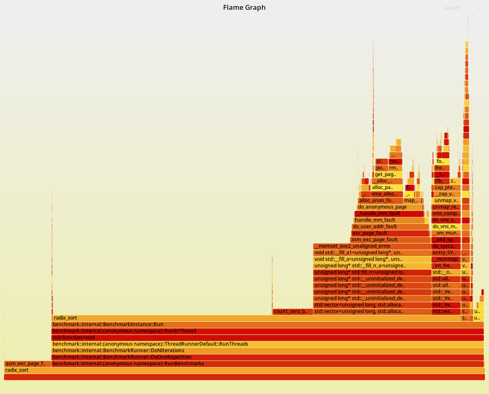](mr_assets/radixsort_before.svg) | [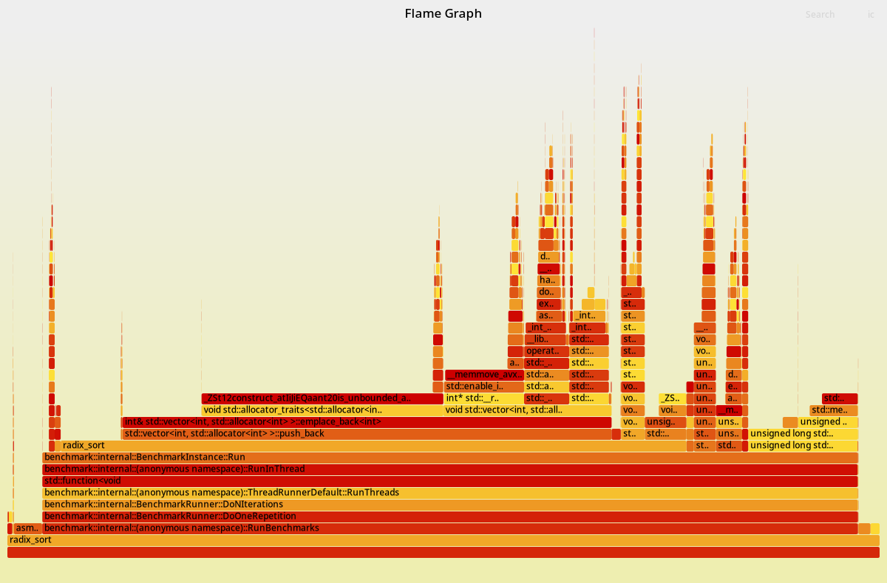](mr_assets/radixsort_after.svg) |

---

## JSON

Json: 31.09% сьедает переопределенный оператор и 27.66% еще сразу в to_json благодаря <<. В общем все тратится на << строки в ostream. Сделаем с помощью string.append, без стримов, так явно будет быстрее. Получаем как раз улучшение в 2.5 раза. Ускорилось потому что operator<< представлял из себя копирование строки(примерно 40%) и вспомогательные методы. Мы оставили только копирование.

### Бенчмарк

| До | После |
|---|---|
| **566 ns** | **204 ns** |
| 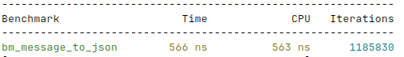 | 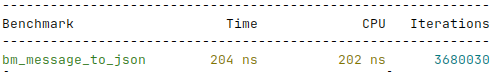 |

### perf

| До | После |
|---|---|
| [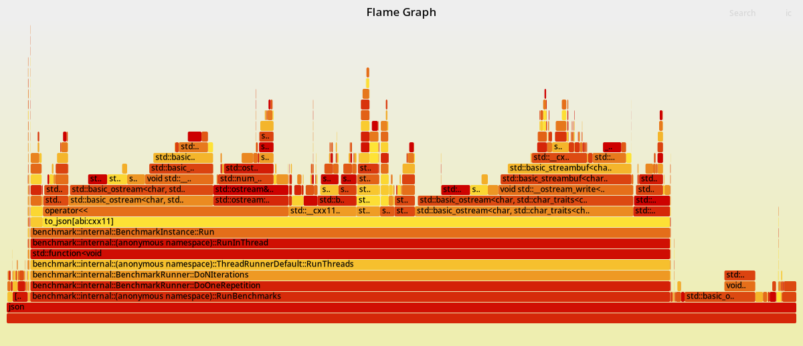](mr_assets/json_before.svg) | [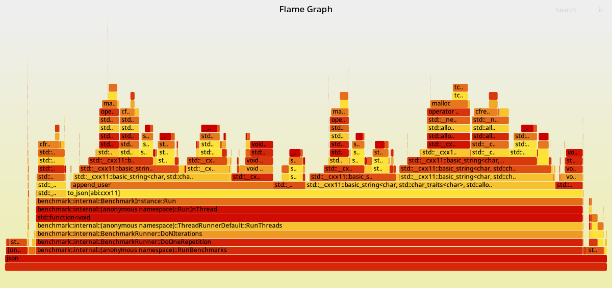](mr_assets/json_after.svg) |

---

## Logger

Json: write - системный вызов, поэтому поэтому только его вызов достаточно тяжелый, уменьшим количество вызовов write с помощью буффера. Оптимизация более чем 25 раз.

### Бенчмарк

| До | После |
|---|---|
| **325 ns** | **10.5 ns** |
| 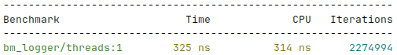 | 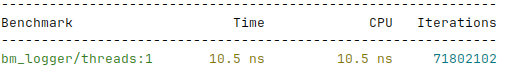 |

### perf

| До | После |
|---|---|
| [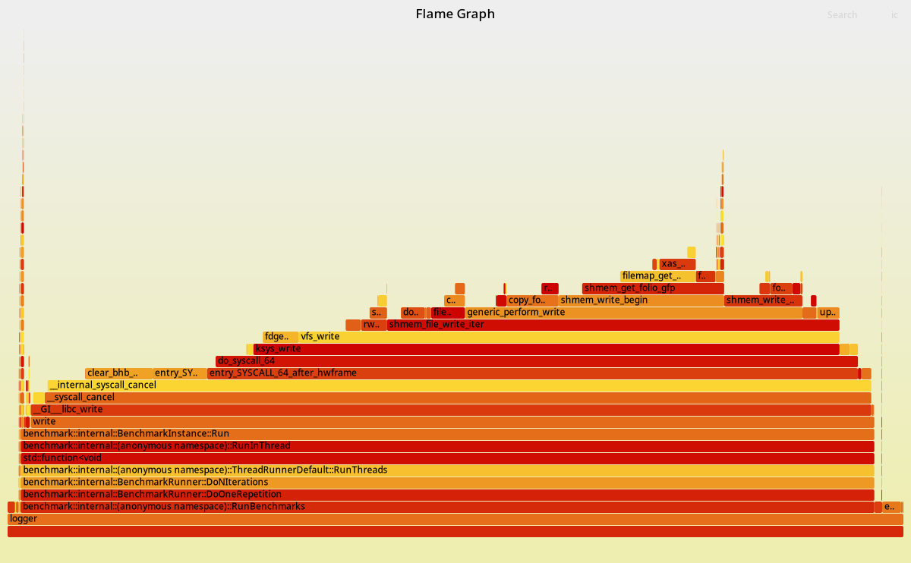](mr_assets/logger_before.svg) | [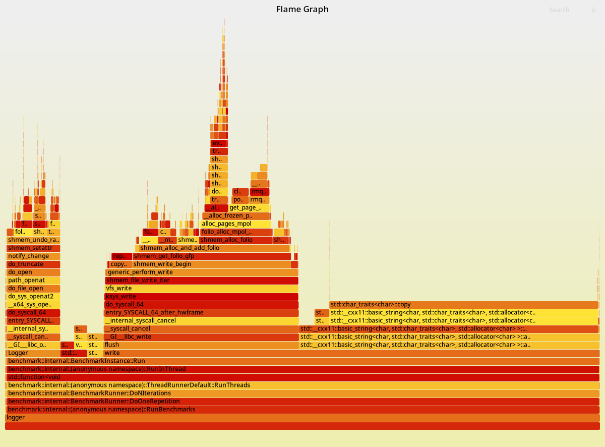](mr_assets/logger_after.svg) |
